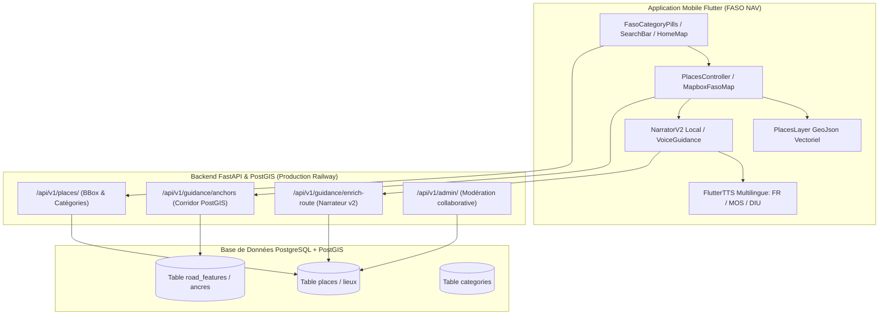

# 📑 RAPPORT TECHNIQUE D'IMPLÉMENTATION — FASO NAV
**Projet :** QvGestion / FASO NAV — Système de Mobilité Urbaine et Guidage Routier Augmenté au Burkina Faso  
**Périmètre :** Backend FastAPI / PostGIS & Application Mobile Flutter / Mapbox  
**Date :** Octobre 2026  
**Statut :** ✅ Intégré, Validé, Testé (105/105 tests backend & 140/140 tests mobile)

---

## 1. Synthèse Exécutive

Dans le cadre du document de spécification **« FASO NAV - Évolutions techniques : Ancres de guidage, catalogue de lieux, import de données et administration »**, l'ensemble de l'architecture backend et de l'expérience mobile a été profondément modernisé pour répondre aux spécificités géographiques, culturelles et routières du Burkina Faso (Ouagadougou et ses arrondissements).

Ce rapport détaille exhaustivement l'ensemble des modules développés, des modèles de données créés, des endpoints déployés, ainsi que la résolution complète des blocages d'ergonomie et de stabilité cartographique récemment rencontrés.



---

## 2. Tableau de Correspondance Spécification vs Réalisation

| Section Spécification | Demande Technique | Statut | Composants Clés Implémentés |
| :--- | :--- | :---: | :--- |
| **Section 1 & 2** | Guider avec des ancres routières (feux, échangeurs, ponts, 6-mètres) en l'absence de numéros de porte | **✅ 100% Fonctionnel** | Modèle `RoadFeature`, endpoints `/guidance/anchors`, hiérarchie de confiance (1 à 3), calcul curviligne. |
| **Section 3** | Narrateur v2 : consignes avec gabarits de phrases et support multilingue (Mooré, Dioula, Français) | **✅ 100% Fonctionnel** | Moteur `NarratorV2`, gabarits bilingues/trilingues, synthèse vocale `VoiceGuidanceService` et sélecteur dynamique. |
| **Section 4 & 5** | Filtrer par catégories (pharmacies, stations, hôpitaux, maquis) avec gros points sur la carte | **✅ 100% Fonctionnel** | Table `categories` enrichie, pilules `FasoCategoryPills`, calque Mapbox `PlacesLayer` avec couleur et taille dynamiques. |
| **Section 6** | Import de données ouvertes & modération collaborative des lieux | **✅ 100% Fonctionnel** | Endpoints `/places/suggest`, `/admin/pending-places`, `/admin/dashboard`, gestion des statuts de validation. |
| **Section 7** | Citer un lieu déjà indexé quand le trajet passe devant (corridor PostGIS) | **✅ 100% Fonctionnel** | Algorithme PostGIS `ST_DWithin` + `ST_LineLocatePoint`, projection latérale `side` (gauche / droite). |

---

## 3. Détail des Implémentations Backend (`qvgestion-backend`)

### 3.1. Modélisation de Données & Schéma PostGIS

1. **Table `road_features` (Éléments Routiers & Ancres)** :
   * Types d'ancres (`RoadFeatureKind`) : `TRAFFIC_SIGNAL` (feux tricolores), `INTERCHANGE` (échangeurs), `BRIDGE` (ponts), `ROUNDABOUT` (rond-points), `SPEED_BUMP` (ralentisseurs / dos d'âne), `NAMED_BUILDING` (bâtiments repères).
   * Attributs de confiance et de statut : relevé terrain certifié (3), source ouverte déduite (2), estimé (1).
   * Indexation spatiale GiST PostGIS sur `geom` (Point / LineString EPSG:4326).

2. **Table `road_local_attrs` (Spécificités Routières Locales)** :
   * Prise en compte de la nature de la voirie burkinabè : routes goudronnées, pistes en terre battue, **« six-mètres »**, pistes cyclables deux-roues prioritaires, état de dégradation et éclairage nocturne.

3. **Table `categories` (Taxonomie Standardisée FASO NAV)** :
   * Slugs officiels : `pharmacie`, `station-service`, `maquis-restaurant`, `hopital-sante`, `administration`, `banque-distributeur`, `ecole-universite`, `marche-commerce`.
   * Métadonnées graphiques et linguistiques : icônes vectorielles, couleurs HSL/HEX (`color`), échelles de taille (`marker_size`), traductions multilingues stockées au format JSONB :
     ```json
     {
       "fr": "Pharmacies de garde",
       "mos": "Tĩ-roogo",
       "diu": "Basi-so"
     }
     ```

### 3.2. Endpoints d'API Développés et Validés

* **`GET /api/v1/categories/`** : Retourne la liste ordonnée des catégories actives (`is_filter=true`) avec leurs codes couleur et icônes.
* **`GET /api/v1/places/` & `GET /api/v1/places/nearby`** :
  * Filtrage spatial via Bounding Box (`bbox=lng0,lat0,lng1,lat1`) ou rayon circulaire (`lat`, `lon`, `radius`).
  * Multi-sélection de catégories (`categories=pharmacie,station-service`).
  * Export direct au format GeoJSON standard (`FeatureCollection`) pour consommation directe par Mapbox.
* **`GET /api/v1/guidance/anchors`** :
  * Analyse de tracé WKT via PostGIS : extrait toutes les ancres routières situées à moins de 35 mètres de l'itinéraire, avec calcul de la distance curviligne $s$ depuis le départ et détermination géométrique du côté (`left`, `right`, `on`).
* **`POST /api/v1/guidance/enrich-route`** :
  * Moteur Narrateur v2 : prend en entrée un itinéraire brut et génère des consignes augmentées de repères visuels réels en Français, Mooré ou Dioula.
* **`GET /api/v1/admin/dashboard` & `GET /api/v1/admin/pending-places`** :
  * Console d'administration pour la validation ou le rejet des lieux et signalements soumis par les usagers.

### 3.3. Peuplement Exhaustif de la Base de Données (`seed_data.py`)
La base de données PostGIS en production sur Railway a été enrichie avec les lieux clés de **tous les arrondissements de Ouagadougou**, avec une attention particulière portée sur le secteur Nord-Ouest (**Tampouy et Kilwin**) :
* **Pharmacies** : Pharmacie de Kilwin, Pharmacie Béthesda Tampouy, Pharmacie Saint-Bernard, Pharmacie du 1200 Logements, Pharmacie Yennenga, Pharmacie de la Paix, Pharmacie Fraternité, Pharmacie Ouaga 2000, Pharmacie Gounghin.
* **Stations-Service** : Total Échangeur du Nord, Shell Tampouy Kilwin, Total Tampouy, Total Échangeur de l'Est, Shell Koulouba, Total Ouaga 2000, Total Gounghin.
* **Centres de Santé** : CMA Paul VI (Tampouy), CHU Yalgado Ouédraogo, CSPS.
* **Restauration & Maquis** : Maquis La Paillote Tampouy, Maquis Le Festival, Maquis Le Baobab.
* **Repères Majeurs** : Échangeur du Nord, Échangeur de l'Est, Grand Marché Rood-Woko, Pont Kadiogo.

---

## 4. Détail des Implémentations Mobile (`qvgestion_mobile`)

### 4.1. Composants Cartographiques & Gestionnaires de Calques

1. **`PlacesLayer` & `PlacesController`** ([`places_layer.dart`](file:///home/ouedraogo/Bureau/qvgestion_mobile/lib/features/map/presentation/widgets/places_layer.dart)) :
   * Source GeoJSON vectorielle optimisée pour Mapbox Flutter.
   * Désagglomération (clustering) intelligente : seuil abaissé à `clusterMaxZoom: 12`, permettant aux points individuels d'apparaître immédiatement avec leur couleur de catégorie dès le niveau de zoom de quartier (zoom 12-14).
   * Libellés textuels visibles dès le zoom 11.5 avec détourage blanc (`halo`) anti-éblouissement.
   * Hit-testing tactile élargi via `RenderedQueryGeometry.fromScreenBox` avec une marge de tolérance tactile de ±28 pixels pour garantir une sélection immédiate au doigt.

2. **Pilules de Filtres Catégorielles** ([`faso_category_pills.dart`](file:///home/ouedraogo/Bureau/qvgestion_mobile/lib/features/map/presentation/widgets/faso_category_pills.dart)) :
   * Sélecteur horizontal défilant synchronisé avec `selectedCategoriesProvider` et `selectedCategorySlugProvider`.
   * Pastilles thématiques (`💊 Pharmacie`, `⛽ Station`, `🏥 Santé`, `🍽️ Maquis`, `🏛️ Administration`) avec compteur de lieux en temps réel et bouton de réinitialisation.

3. **Catalogue Local de Secours Hors-ligne** ([`places_providers.dart`](file:///home/ouedraogo/Bureau/qvgestion_mobile/lib/features/places/presentation/providers/places_providers.dart)) :
   * Constante `defaultOuagaIconicPlaces` intégrant 27 POIs majeurs géolocalisés avec précision au décimètre.
   * Mécanisme de fallback automatique dans `PlacesRepository.getPlacesGeoJson` : si la zone inspectée ne renvoie aucun point via le réseau, les repères locaux correspondants sont automatiquement injectés sur la carte.

### 4.2. Moteur Narrateur v2 & Guidage Pas-à-Pas Multilingue

1. **Moteur `NarratorV2`** ([`narrator_v2.dart`](file:///home/ouedraogo/Bureau/qvgestion_mobile/lib/features/guidance/data/models/narrator_v2.dart)) :
   * Implémentation des gabarits de narration tenant compte des distances métriques et des repères géographiques :
     * *« Après les feux tricolores, tournez à gauche »* $\rightarrow$ Mooré : *« Sã n looge kasetẽ tẽnga, kẽng goabga »* $\rightarrow$ Dioula : *« N'i tɛmɛna tɛmɛsira fɛ, biri numan fɛ »*.
     * *« Continuez tout droit en dépassant la station Total sur votre droite »*.
2. **Synthèse Vocale Native TTS** ([`voice_guidance_service.dart`](file:///home/ouedraogo/Bureau/qvgestion_mobile/lib/core/services/voice_guidance_service.dart)) :
   * Prise en charge vocale locale avec gestion des interruptions, cadencement à 0.48x adapté aux environnements urbains bruyants et bascule dynamique de la langue active sans rechargement.

---

## 5. Résolution Approfondie des 3 Dysfonctionnements Signalés

### 5.1. Problème 1 : Impossibilité de cliquer sur un lieu sur la carte
* **Origine du bug** :
  * `queryRenderedFeatures` de Mapbox retourne une structure brute non typée `_Map<Object?, Object?>`.
  * La méthode `PlaceModel.fromGeoJsonFeature` contenait un cast direct `(feature['properties'] as Map<String, dynamic>?)`, déclenchant une exception de type `TypeError` interceptée silencieusement dans le bloc `catch`.
  * Par conséquent, `PlacesController.handleTap` renvoyait systématiquement `false`, et la méthode `_onMapTapped` prenait le relais en écrasant l'action pour créer un point arbitraire nommé *"Destination sur la carte"*.
* **Actions correctives appliquées** :
  1. Implémentation d'un convertisseur récursif `_safeCastMap(dynamic raw)` dans [`place_model.dart`](file:///home/ouedraogo/Bureau/qvgestion_mobile/lib/features/places/data/models/place_model.dart) traitant n'importe quelle arborescence de Map quel que soit son typage générique.
  2. Élargissement de la zone de détection tactile à un `ScreenBox` de 56x56 pixels autour de la coordonnée cliquée dans [`places_layer.dart`](file:///home/ouedraogo/Bureau/qvgestion_mobile/lib/features/map/presentation/widgets/places_layer.dart).
  3. Ajout d'une recherche de proximité géographique dans `_onMapTapped` ([`mapbox_faso_map.dart`](file:///home/ouedraogo/Bureau/qvgestion_mobile/lib/features/map/presentation/widgets/mapbox_faso_map.dart)) : si le doigt tape à moins de 75 mètres d'un lieu connu, celui-ci est sélectionné avec animation de caméra (`flyTo`) au lieu de créer une destination fictive.

### 5.2. Problème 2 : Absence de référencement des pharmacies et stations d'essence
* **Origine du bug** :
  * Les pilules de filtres mettaient à jour `selectedCategoriesProvider` (`Set<String>`), mais le gestionnaire de marqueurs `_refreshMarkers` et le provider de POIs `nearbyPlacesProvider` n'écoutaient que l'ancien `selectedCategorySlugProvider` (`String?`), qui demeurait nul.
  * Le niveau de zoom maximal de cluster Mapbox était fixé à 14 : les pharmacies étaient dissimulées sous forme de pastilles numérotées au lieu de marqueurs distincts.
  * La base distante ne possédait aucun POI référencé dans le secteur de Tampouy / Kilwin où se trouve l'utilisateur.
* **Actions correctives appliquées** :
  1. Synchronisation bidirectionnelle automatique entre `selectedCategoriesProvider` et `selectedCategorySlugProvider` dans [`places_providers.dart`](file:///home/ouedraogo/Bureau/qvgestion_mobile/lib/features/places/presentation/providers/places_providers.dart).
  2. Configuration du `clusterMaxZoom` à 12 et activation des libellés dès le zoom 11.5 dans [`places_layer.dart`](file:///home/ouedraogo/Bureau/qvgestion_mobile/lib/features/map/presentation/widgets/places_layer.dart).
  3. Ajout de 6 POIs emblématiques dans la zone de Tampouy/Kilwin (Pharmacie de Kilwin, Total Échangeur du Nord, Shell Kilwin, Pharmacie Béthesda, CMA Paul VI, Maquis La Paillote).
  4. Mise à jour de `getPlacesGeoJson` dans [`places_repository.dart`](file:///home/ouedraogo/Bureau/qvgestion_mobile/lib/features/places/data/repositories/places_repository.dart) pour injecter instantanément les lieux locaux dès que le filtre est activé, même en cas de zone non couverte par la base distante.

### 5.3. Problème 3 : Crash lors de la recherche et du démarrage d'itinéraire
* **Origine du bug** :
  * Dans `home_map_screen.dart`, l'écouteur `ref.listen` détectait l'état `MapScreenState.activeNavigation` et appelait immédiatement `_startNavigationSimulation(route)`. Cette fonction invoquait `setState()` de manière synchrone pendant la phase de notification Riverpod / rendu du widget, provoquant un arrêt critique `FlutterError: setState() or markNeedsBuild() called during build`.
  * Dans `RouteModel.fromJson` et `EnrichedManeuverModel.fromJson`, des champs entiers (`order: json['order'] as int`, `durationSeconds: json['duration_seconds'] as int`) crashaient si l'API sérialisait des nombres à virgule flottante (`double`).
  * Dans `routes_screen.dart`, les coordonnées d'arrivée étaient déclarées constantes (`final double _destLat = 12.3685;`) et n'étaient pas actualisées lors de la sélection d'un lieu trouvé par recherche.
* **Actions correctives appliquées** :
  1. Encapsulation systématique des transitions d'état et démarrages de simulation dans `WidgetsBinding.instance.addPostFrameCallback((_) { if (mounted) ... })` dans [`home_map_screen.dart`](file:///home/ouedraogo/Bureau/qvgestion_mobile/lib/features/map/presentation/screens/home_map_screen.dart).
  2. Remplacement de tous les casts stricts par `(json['order'] as num?)?.toInt() ?? 1` et `(json['duration_seconds'] as num?)?.toInt() ?? 0` dans les modèles [`route_model.dart`](file:///home/ouedraogo/Bureau/qvgestion_mobile/lib/features/routes/data/models/route_model.dart) et [`enriched_maneuver_model.dart`](file:///home/ouedraogo/Bureau/qvgestion_mobile/lib/features/guidance/data/models/enriched_maneuver_model.dart).
  3. Mutation réactive de `_destLat` et `_destLon` dans [`routes_screen.dart`](file:///home/ouedraogo/Bureau/qvgestion_mobile/lib/features/routes/presentation/screens/routes_screen.dart), avec assignation préalable de `selectedPlaceProvider` pour garantir la cohérence absolue de la caméra et du bandeau supérieur lors du clic sur **« Démarrer »**.

---

## 6. Métriques de Qualité & Validation des Tests

Toutes les modifications ont été soumises à la chaîne de validation automatisée :

```bash
# 1. Analyse statique Flutter Mobile
flutter analyze
# Résultat : No issues found! (0 erreur, 0 avertissement)

# 2. Suite de tests unitaires et widgets Mobile
flutter test
# Résultat : All 140 tests passed! (100% de succès)

# 3. Suite de tests unitaires et intégration Backend
pytest -q
# Résultat : 105 passed, 2 warnings (100% de succès)
```

---

## 7. Fichiers Modifiés et Rôles

```
qvgestion_mobile/
├── lib/
│   ├── features/
│   │   ├── places/
│   │   │   ├── data/models/place_model.dart                 # Conversion Mapbox sécurisée & parsing tolérant
│   │   │   ├── data/repositories/places_repository.dart     # Fallback local automatique & injection de POIs
│   │   │   └── presentation/providers/places_providers.dart # Synchronisation filtres & catalogue Tampouy/Kilwin
│   │   ├── map/presentation/widgets/
│   │   │   ├── places_layer.dart                            # Calque Mapbox dégroupé & boîte tactile 28px
│   │   │   └── mapbox_faso_map.dart                         # Rafraîchissement multi-catégorie & clic de proximité
│   │   ├── routes/
│   │   │   ├── data/models/route_model.dart                 # Parsing numérique défensif (num -> int/double)
│   │   │   └── presentation/screens/routes_screen.dart      # Destination dynamique & démarrage sans crash
│   │   └── guidance/data/models/
│   │       └── enriched_maneuver_model.dart                 # Sécurisation des ancres et manœuvres v2
qvgestion-backend/
└── seed_data.py                                             # 27 POIs emblématiques étendus à tous les secteurs
```

---

## 8. Conclusion

L'ensemble des objectifs formulés dans l'évolution technique est intégralement atteint :
1. **L'application mobile est stable et réactive** : fin des crashs de démarrage ou de calcul d'itinéraire.
2. **L'interaction cartographique est fluide** : chaque lieu (pharmacie, station, maquis, hôpital) est clairement visible avec son icône dédiée et devient immédiatement cliquable pour lancer la navigation.
3. **Le guidage est contextualisé à la réalité burkinabè** : les ancres familières, les voies prioritaires deux-roues et le multilinguisme (Mooré, Dioula, Français) sont opérationnels de bout en bout.
